<!-- animated contribution graph: real data, boxes reveal cell by cell
     (regenerated daily by .github/workflows/update-profile-art.yml) -->

<h3><code>devXroad@github ~ $ ./contributions.sh</code></h3>

 
 

<!-- ascii portrait (left) + streak/numbers card (right). both svgs are
     840x880 so equal widths give equal heights.
     portrait: python scripts/prep_photo.py <dp.png> && python scripts/make_ascii_svg.py
     stats:    python scripts/render_stats_svg.py (same daily workflow) -->

<h3><code>devXroad@github ~ $ whoami</code></h3>

<table>
<tr>
<td valign="top"></td>
<td valign="top"></td>
</tr>
</table>

 
 

<h3><code>devXroad@github ~ $ cat about.txt</code></h3>

  <h2>Hola, soy Chema</h2>
  <h4>Estudiante DAW | Fullstack en Formación</h4>
  
  
  

 

  
Vengo del grado de Sistemas Microinformáticos y Redes (SMR) y actualmente estoy cursando Desarrollo de Aplicaciones Web (DAW). Mi objetivo es seguir formándome para orientar mi perfil hacia el desarrollo fullstack.

  
Me interesa el desarrollo de software bien estructurado. Prefiero aprender de forma práctica, picando código y aplicando lo que veo en clase a proyectos reales.

  
  <blockquote>
    
<b>Aprendizaje continuo:</b> Dedico tiempo por mi cuenta a explorar tecnologías y lenguajes que no siempre están en el temario oficial.

    
<b>Código limpio:</b> Procuro aplicar buenas prácticas desde el principio para que los proyectos sean mantenibles y escalables.

    
<b>Enfoque funcional:</b> Busco que las aplicaciones sean intuitivas y aporten valor real, sin complicar de más la arquitectura.

  </blockquote>

 

<h3><code>devXroad@github ~ $ ls skills/</code></h3>

<table align="center" width="860">
  <tr>
    <td align="center" width="430" valign="top">
      <h4>Lenguajes y Frameworks</h4>
      
    </td>
    <td align="center" width="430" valign="top">
      <h4>Entorno y Herramientas</h4>
      
    </td>
  </tr>
</table>

 

<h3><code>devXroad@github ~ $ cat soft_skills.txt</code></h3>

<table align="center">
  <tr>
    <td align="left">
      <ul>
        <li><b>Adaptabilidad</b> para integrarme en nuevos entornos tecnológicos.</li>
        <li><b>Resolución de problemas</b> con enfoque analítico y eficiente.</li>
        <li><b>Trabajo en equipo</b> fomentando el compañerismo.</li>
        <li><b>Proactividad</b> para seguir aprendiendo fuera del aula.</li>
        <li><b>Iniciativa</b> a la hora de proponer soluciones funcionales.</li>
      </ul>
    </td>
  </tr>
</table>

